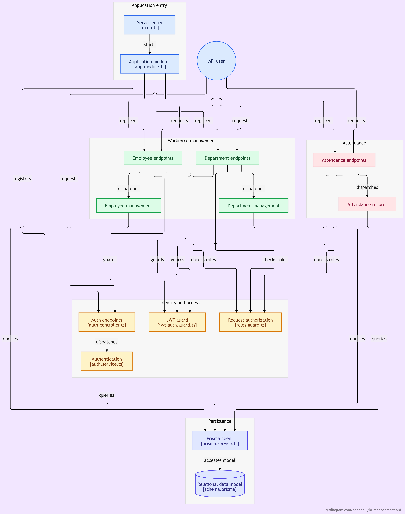

# HR Management API

A REST API for managing employees, departments, attendance and access control, built with **NestJS**, **Prisma** and **PostgreSQL**.

## Architecture



## Tech Stack

| Layer      | Technology                         |
| ---------- | ---------------------------------- |
| Framework  | NestJS 11 (TypeScript)             |
| ORM        | Prisma 5                           |
| Database   | PostgreSQL                         |
| Auth       | JWT (passport-jwt), bcrypt         |
| Validation | class-validator, class-transformer |

## Features

**Departments**

- CRUD with unique department codes
- Assign and remove department managers
- Managers are cleared automatically when they transfer or resign

**Employees**

- CRUD with search, filters and pagination
- Soft delete (resignation changes status instead of deleting)
- Salary is visible only to HR and ADMIN, excluded at the query level

**Authentication & Authorization**

- JWT login, accounts created by HR/ADMIN only
- Role-based access control: `ADMIN`, `HR`, `MANAGER`, `EMPLOYEE`
- Roles are loaded fresh from the database on every request, so role changes take effect immediately
- Resigned employees lose access instantly, even with an unexpired token
- Users can change their own password

**Attendance**

- Check-in / check-out using server time (employees cannot submit their own timestamps)
- Late minutes calculated in Thailand time (UTC+7), independent of server timezone
- Managers see only their own department; HR and ADMIN see everyone

## Permissions

| Action                              | EMPLOYEE | MANAGER  | HR  | ADMIN |
| ----------------------------------- | :------: | :------: | :-: | :---: |
| View employees & departments        |    ✅    |    ✅    | ✅  |  ✅   |
| View salaries                       |    ❌    |    ❌    | ✅  |  ✅   |
| Create / update / resign employees  |    ❌    |    ❌    | ✅  |  ✅   |
| Manage departments & managers       |    ❌    |    ❌    | ✅  |  ✅   |
| Check in / out, view own attendance |    ✅    |    ✅    | ✅  |  ❌   |
| View others' attendance             |    ❌    | Own dept | ✅  |  ✅   |
| Create user accounts                |    ❌    |    ❌    | ✅  |  ✅   |
| Change user roles                   |    ❌    |    ❌    | ❌  |  ✅   |

## Getting Started

### Prerequisites

- Node.js
- Yarn
- PostgreSQL

### Setup

```bash
git clone https://github.com/panapolll/hr-management-api.git
cd hr-management-api
yarn
```
